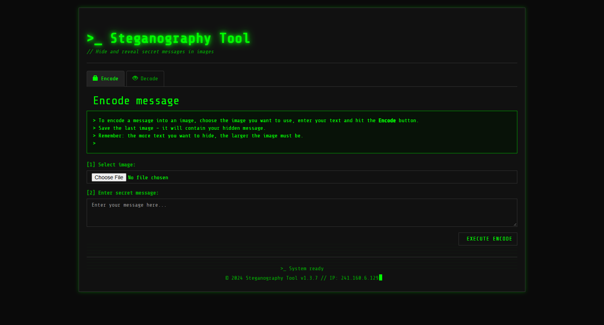
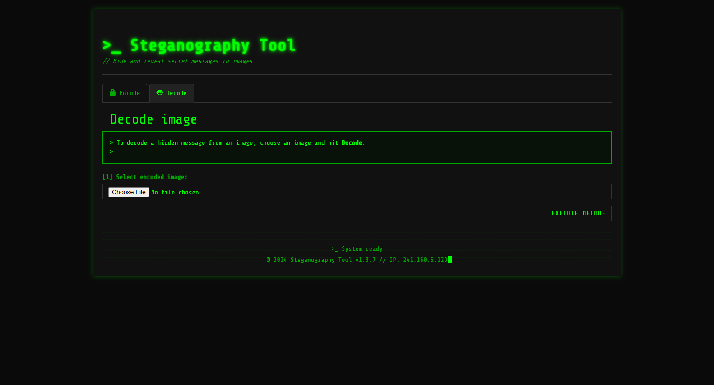

# Steganography_Image_Encoder_Decoder_Web_Application

<p align="center">
  
  
  
  
  
</p>

An interactive browser-based Image Steganography Encoder & Decoder web application built with a retro cyberpunk terminal interface. Conceal confidential text messages invisibly inside image pixels using Least Significant Bit (LSB) encoding, and decode hidden text payloads with zero server dependencies.

---

## 📸 Hero Preview

<p align="center">
  
</p>

## 🖼️ UI Snapshot Gallery

<p align="center">
  
</p>

---

## ✨ Features

- 🔒 **Least Significant Bit (LSB) Encoding** - Embeds binary message payloads into the lower-order bits of image pixels with imperceptible visual distortion.
- 🔓 **Instant Text Extraction** - Reconstructs UTF-8 secret text strings from encoded PNG carrier files in sub-seconds.
- 📊 **Binary Payload Inspector** - Inspect the raw binary bitstream generated during encoding before writing to canvas.
- 🛡️ **100% Private Client-Side Processing** - Powered purely by HTML5 Canvas; images and secrets are never sent over a network.
- 💻 **Cyberpunk Terminal Aesthetic** - High-contrast green phosphor styling, Share Tech Mono typography, and active terminal logs.

---

## 🛠️ Tech Stack

- **Core**: Vanilla JavaScript (ES6+), HTML5 Canvas API
- **Styling**: Bootstrap 3, Modern CSS Cyber Theme
- **Fonts**: Share Tech Mono

---

## 🚀 Quick Start

### 1. Clone the repository
```bash
git clone https://github.com/soorajstudio/Steganography_Image_Encoder_Decoder_Web_Application.git
cd Steganography_Image_Encoder_Decoder_Web_Application
```

### 2. Run locally
```bash
# Using Python
python -m http.server 8080

# Or using Node
npx serve .
```

Open [http://localhost:8080/Stego.html](http://localhost:8080/Stego.html) in your browser.

---

## 📄 License

This project is licensed under the MIT License — see the [LICENSE](LICENSE) file for details.

Developed with ❤️ by [Sooraj Studio](https://github.com/soorajstudio).
